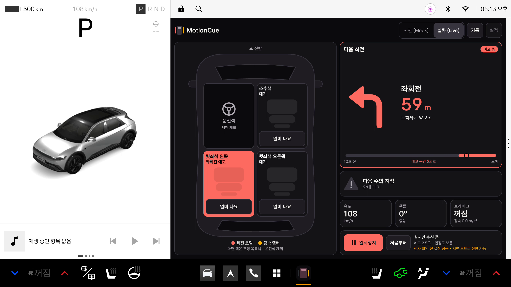
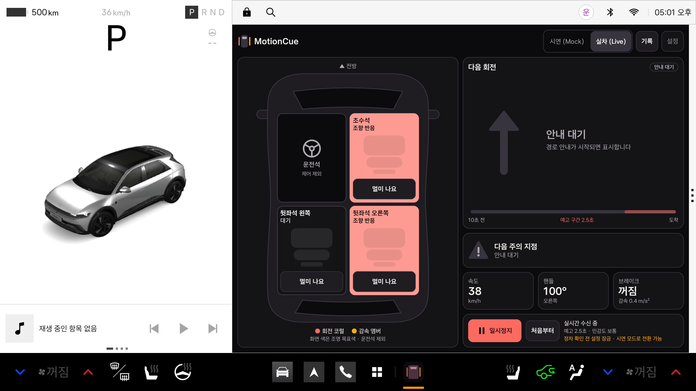
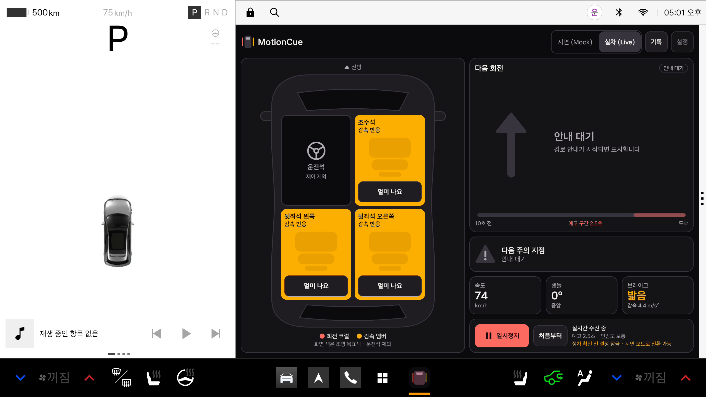

# MotionCue

**내비게이션 안내와 차량 입력을 받아, 회전·감속을 좌석별 조명 색으로 동승자에게 알려 주는 Pleos Connect 앱입니다.** 차멀미 완화를 목표로 개발한 데모이며, 실제 탑승자의 개선 효과는 아직 검증하지 않았습니다.

회전 예고는 남은 거리와 현재 추정 속도로 계산한 **도착 예상 시간(ETA)**을 기준으로 합니다. 기본 예고 구간은 ETA 2.5초 이내이며 1~4초로 설정합니다. 이후 속도와 경로 진행에 따라 실제 회전까지 남은 시간이 달라지므로, 정확히 2.5초 먼저 알린다는 보장은 아닙니다.



| 오른쪽 조향 반응 | 감속 반응 |
|---|---|
|  |  |

## 동작 원리

1. **입력**: 내비의 다음 회전(TBT)·주의 지점과 조향각, 브레이크, 위치를 Pleos SDK에서 받습니다. 시연 모드는 같은 형식의 95초 합성 시나리오를 재생합니다.
2. **예측 큐**: 도착 예상 시간(남은 거리 ÷ 추정 속도)이 설정한 예고 구간(기본 2.5초, 범위 1~4초) 안에 들어오면 켭니다. 화면의 ETA 타임라인에서 점이 칠한 구간에 들어오는 순간입니다. 저속에서는 근접 거리 조건을 사용합니다.
3. **반응 큐**: 안내에 없는 커브와 감속은 핸들 각도와 브레이크 입력으로 표시합니다.
4. **출력**: 좌석 구역별 목표색을 화면 실내도에 표시합니다. 실차(Live)에서 실제 조명 제어를 켜면, 운전석과 공유되지 않는 독립 구역만 제어합니다.

| 상황 | 색 | 좌석 |
|---|---|---|
| 좌회전 | 코럴 | 뒷좌석 왼쪽 |
| 우회전 | 코럴 | 조수석, 뒷좌석 오른쪽 |
| 감속·과속방지턱 | 앰버 | 선택한 동승자 좌석 전체 |
| 운전석 | 없음 | 항상 제어에서 제외 |

큐가 켜진 좌석은 구역 전체를 코럴 또는 앰버 목표색으로 채웁니다. 좌석 이름과 상태 글자는 배경 명도에 따라 대비가 높은 검정/흰색으로 표시하고, 꺼진 좌석과 운전석은 어둡게 유지합니다. 색은 **500ms 페이드**로만 바뀌며 점멸하지 않습니다.

좌석의 **멀미 나요** 버튼은 지원되는 공조·창문 설정과 한국어 음성 안내를 요청하고, 다시 누르거나 앱 화면을 벗어나면 원래 값으로 복원을 요청합니다.

## 실행 방법

저장소: https://github.com/lab-sub/MotionCue

**APK 위치: [apk/MotionCue_release.apk](apk/MotionCue_release.apk)** (버전 0.1.0, 39,594,763 bytes, 패키지 `app.motioncue`)

- SHA-256: `BC22EA0FA38E6A110DEA4AA16ED67845141A539D882EAD3BF6DBB4FB59C26BD5`
- 서명: release 구성, **Android Debug 인증서**, APK Signature Scheme v2 검증 통과. 배포용 개인 키로 서명한 파일은 아닙니다.

1. Pleos 전용 에뮬레이터를 실행하고 설치할 장치·전경 사용자를 확인합니다. 한 장치가 연결된 경우 `adb shell am get-current-user`로 조회합니다.
2. `adb install -r --user <조회한 사용자 ID> apk/MotionCue_release.apk`로 설치하고 앱 목록에서 MotionCue를 엽니다. 여러 장치가 연결됐다면 명령에 `-s <serial>`을 지정합니다.
3. 기본 **시연 (Mock) → 재생**으로 95초 시나리오를 봅니다. 좌회전·방지턱·급우회전·안내 없는 커브·감속이 순서대로 나오며, 차량 장치는 제어하지 않습니다.
4. **일시정지**, **처음부터**, **설정**(예고 시간 1~4초, 대상 좌석, 민감도)을 확인합니다. 입력 출처와 이벤트는 **기록**에서 봅니다.
5. **실차 (Live) → 재생**은 실제 Pleos SDK 정보를 사용합니다. 요청한 권한을 허용하고 내비 경로 안내·Virtual Console 입력·위치 입력을 준비합니다. 서비스나 권한이 없으면 입력이 비어 있거나 해당 기능이 생략될 수 있으니 **기록**에서 확인합니다. 실차 모드의 회복 버튼은 재생 중에만 켜집니다.

현재 앱은 화면이 보이는 동안 동작합니다. 포그라운드 서비스·음성 명령 인식·CarUxRestrictions 연동은 후속 개발 범위입니다. 실차 모드에서 주행 중이거나 속도가 미확인되면 설정을 잠급니다.

## 시연 영상

- [시연 영상 약 2분 25초](demo/MotionCue_demo_ko.mp4), [세로 요약 40초](demo/MotionCue_shortform_ko.mp4). 한국어 AI 내레이션·자막·배경음 포함. 설명용 합성 음성이며 앱 스피커 녹음이 아닙니다.
- 자막 파일: [본편 SRT](demo/MotionCue_demo_ko.srt), [숏폼 SRT](demo/MotionCue_shortform_ko.srt).
- 본편은 회전 예고 → 왼쪽/오른쪽 조향 반응 → 감속 → 95초 Mock 시나리오의 연속 구간 → 회복 요청 → 운전석 제외 순서로 보여 줍니다. 숏폼은 회전 예고 → 조향 → 감속을 압축합니다.
- 앱 장면은 Pleos 에뮬레이터에서 녹화한 실차(Live)·시연(Mock) 실행입니다. 촬영 빌드(SHA-256 `deabf10e38f9…`)와 위 APK의 차이는 패키지 이름 변경뿐이며 화면은 같습니다. 위 APK는 별도로 설치해 재확인했습니다. [제작·검증 범위](demo/MEDIA_NOTES.md), [재확인 요약](verification/anonymized-build.json)
- 예고 장면은 같은 원본 프레임의 좌석·회전/ETA·속도·핸들 패널을 확대 배치한 편집입니다. 예고 설명에 쓰지 않는 브레이크/감속 타일은 제외하며, 화면 값이나 좌석 색을 합성하지 않습니다.

## 실행 환경

| 항목 | 검증한 구성 |
|---|---|
| 대상 | Pleos Connect Emulator v2.1.0, Android API 34 |
| Android | compileSdk/targetSdk 35, minSdk 28 |
| 빌드 | JDK 21, JVM 타깃 17, Gradle 8.10.2, AGP 8.8.2, Kotlin 2.0.0 |
| Pleos SDK | Vehicle 2.3.2, NaviHelper 3.0.5, FusedLocation 1.1.3, TextToSpeech 3.3.1 |
| SDK 저장소 | settings.gradle.kts에 Pleos 공개 Maven 주소 지정 |

일반 스마트폰이나 표준 Android 에뮬레이터는 실행 검증 대상이 아닙니다. Pleos 차량 서비스와 automotive 환경이 필요합니다. Android Studio Gradle JDK는 21로 설정합니다. JDK 25는 이 Gradle 버전의 검증 환경이 아닙니다.

## 빌드와 테스트

Android Studio에서 이 폴더를 열고 Android SDK Platform 35/Build Tools 35.0.0, JDK 21을 준비합니다. `local.properties`에 자신의 `sdk.dir`를 설정합니다. SDK 경로 예시는 `sdk.dir=C:/Android/Sdk`이며 실제 설치 경로를 사용합니다. 이 파일은 Git 제외 대상입니다. 최초 빌드에는 Maven/Gradle 다운로드와 SDK 라이선스 수락이 필요할 수 있습니다.

```powershell
.\gradlew.bat :core:test :app:testDebugUnitTest :app:assembleDebug :app:assembleDebugAndroidTest :app:lintDebug :app:assembleRelease --console=plain
```

한글 경로에서 JVM 테스트 클래스를 찾지 못하면 프로젝트를 이동하지 않고 비어 있는 드라이브 문자로 `subst` 매핑해 실행할 수 있습니다. 기존 드라이브 매핑을 덮어쓰지 않습니다. macOS/Linux는 `./gradlew`를 사용합니다.

새 release는 `app/build/outputs/apk/release/app-release.apk`입니다. 현재 `exportReleaseApk` 작업은 팀 접두사(기본 TEAM)를 붙이므로 이 저장소의 `apk/MotionCue_release.apk`는 검증한 release의 동일 바이트 복사본입니다. 재빌드 후에는 해시와 설치 동작을 다시 확인합니다.

release 키를 사용할 경우 local.properties의 `motioncue.keystore.path`, `motioncue.keystore.password`, `motioncue.key.alias`, `motioncue.key.password`를 로컬에서 설정합니다. 키가 없으면 debug 키로 서명하도록 구성되어 있습니다. 비밀번호·키 파일을 Git에 넣지 않습니다.

## 검증 결과와 한계

**2026-11-02, 위 APK 기준.** core 75 + app 50 = **125개 단위 테스트** 실패·오류·건너뜀 0. debug·release·androidTest 빌드 성공, Lint 오류 0·경고 28(버전 업데이트 및 리소스 관련). [집계 JSON](verification/test-results.json)

패키지 이름 변경 후 위 APK를 Pleos 에뮬레이터에 설치해 재확인했습니다. 설치한 base.apk의 SHA-256이 위 값과 일치합니다. [요약 JSON](verification/anonymized-build.json)

| 재확인 항목 | 결과 |
|---|---|
| Mock | 95초 시나리오 완료(1:35 / 1:35), Fatal Exception 0건 |
| 권한·연결 | Live 재생 시 위치 권한 요청 → 허용 후 SDK 입력 수신, SecurityException 0건 |
| 조향·감속 | 핸들 −100°는 왼쪽 뒷좌석, +100°는 조수석·오른쪽 뒷좌석 코럴. 브레이크 밟음·감속 조건에서 동승자 세 좌석 앰버 |
| 내비 TBT | 실제 내비 경로 안내 중 좌회전·남은 거리 수신, ETA 구간 진입 시 왼쪽 뒷좌석 코럴 |
| 회복 요청 | 조수석 창문 설정값 0→20→0, 온도 설정값 22→20.5→22℃, Pleos TTS 재생 시작·완료 콜백 |

**2026-11-01 관측 (촬영 빌드, 패키지 이름 변경 전).** [기기 검증 요약](verification/provenance.json)

| 관측 항목 | 결과 |
|---|---|
| release 실행 | 설치한 base.apk와 당시 촬영 빌드의 SHA256 일치. 원본 MP4 실제 프레임에서 95초 시나리오 완료(1:35 / 1:35)와 재생 버튼 복귀 확인, 관측한 앱 PID 범위 Fatal Exception 0건 |
| 큐 표시 | 코럴/앰버가 해당 좌석 구역 전체를 채우며 검정 글자가 보이고, 운전석은 어두운 제어 제외 상태를 유지함을 실제 MP4 프레임에서 확인 |
| 회전 예고 | 핸들0° 직진 입력에서 ETA 점이 예고 구간에 들어온 뒤 왼쪽 뒷좌석이 코럴로 채워지는 과정을 연속 녹화로 확인. 검토 프레임의 ETA 약4초→약2초 전환과 좌석 페이드를 확인 |
| 조향·감속 | 내비 안내를 끈 상태에서 핸들 −100°는 왼쪽 뒷좌석, +100°는 오른쪽 두 좌석 코럴. 핸들0°·브레이크 밟음에서 감속 조건 충족 시 동승자 세 좌석 앰버, 조건 해제 시 어두운 대기로 복귀 |
| 회복 요청 | 정차 상태에서 요청 → 회복 중 → 원래대로 복귀 UI와 조수석 창문 설정값0→20→0을 확인. 당시 온도 읽기 불가로 그 촬영에서는 온도 조정 성공을 확인하지 못함 |

**2026-10-31 계측 (이전 화면, 같은 판정 코드).** 실제 production Live 경로 1,472개 상태에서 운전석 큐 없음, 잘못된 색 없음, 입력 요청 오류 0. 왼쪽 조향 84/84, 오른쪽 조향 85/85 샘플 코럴 큐, 고속 내비 예고 구간 96샘플 중 88개 코럴 예고.

**2026-10-29 관측 (이전 화면).** 안내 취소 후 30초·277개 상태에서 다음 회전·활성 큐 없음. 조수석 온도 설정값 22→20.5→22℃, 창문 raw 0→2→0을 별도 SDK로 읽음. 화면 비활성화 뒤 복원, 명시적 재개, Pleos 한국어 ON_DEVICE 재생 시작·완료 콜백. 위 관측은 당시의 기록이며 이번 촬영의 회복 요청·창문 설정값 변화와 구분합니다. 온도 조정 성공과 전체 복원 회귀 시험을 이번 결과로 재계산하지 않습니다.

Live 녹화는 `lightingEnabled=false`이며 앱 기록의 “조명: 화면 전용” 표시를 확인했습니다. 화면 목표색과 입력 반응을 확인한 것이며 실제 램프의 색·물리 복원 동작을 확인한 것이 아닙니다.

- 좌핸들 기준 운전석과 공유·미확인 구역은 제어하지 않습니다. 전체 관측에서 운전석 큐가 없었습니다. 우핸들은 지원하지 않습니다.
- 현재 에뮬레이터 조명과 풍량은 운전석 공유 구역이어서 실제 제어를 생략했습니다. 화면의 색은 **큐 목표색**으로 실제 램프의 측정값이 아닙니다.
- Live 속도는 FusedLocation/내비 기반 추정값으로 에뮬레이터 GPS 입력에서 속도의 비단조 변화와 감속 추정 변동이 관측됐으며, 이 가상 입력 녹화는 실제 차량의 안정 주행 검증이 아닙니다. 예고는 현재 추정 속도의 ETA 기준이고 감속 큐는 브레이크·감속 조건을 충족할 때만 켜집니다.
- 실제 차량, 실제 스피커 청취, 물리 터치·전원 단절, 탑승자 멀미 개선 효과는 확인하지 않았습니다. 강제 종료나 차량 서비스 단절 후 원상복원을 보장하지 않습니다.

## 구성과 제출 범위

- `core/`: 순수 Kotlin 큐 엔진·속도 추정·페이드·Mock 시나리오·단위 테스트
- `app/`: Compose UI, Mock/Live 입력, SDK 연결, 제어·회복·음성·세션 관리 및 테스트
- `apk/`: release APK — 빌드·서명·설치·Mock 95초 완주 확인
- `demo/`: 시연 영상
- `docs/screenshots/`: 앱 화면
- `verification/`: 공유용 테스트·출처 요약

서명된 신청서·연락처·개인 경로 문서·local.properties·서명 키·SDK 분석용 바이너리·원시 실행 로그·캐시는 포함하지 않습니다.

Pleos SDK와 외부 의존성의 권리는 각 권리자에게 있습니다. 이 저장소에 별도의 오픈소스 라이선스를 임의로 부여하지 않았습니다. 공개 Maven 의존성은 빌드 시 내려받으며, 분석용 SDK 바이너리를 별도로 포함하지 않습니다. 공식 개발 자료: https://document.pleos.ai/ 및 https://github.com/Pleos-Playground/pleos-sample-vehicle-app

공식 제출 안내: https://appdevchallenge.auto-hmg.io/guide/submission
